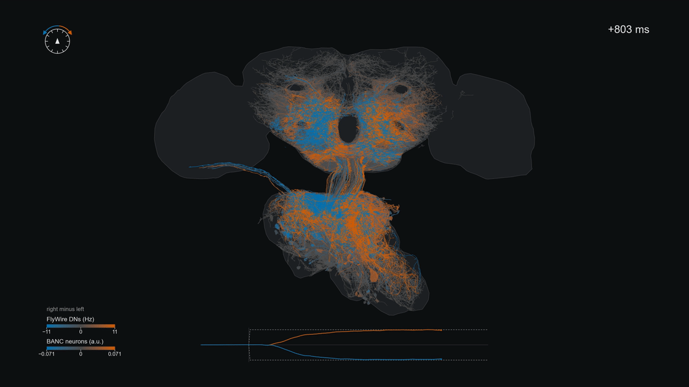
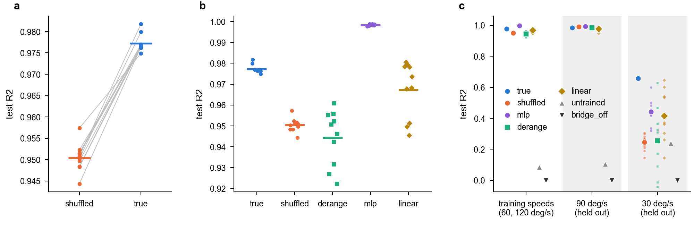
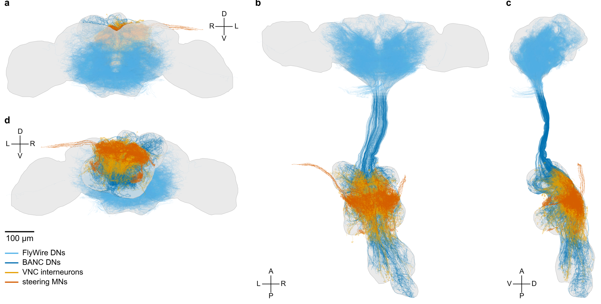
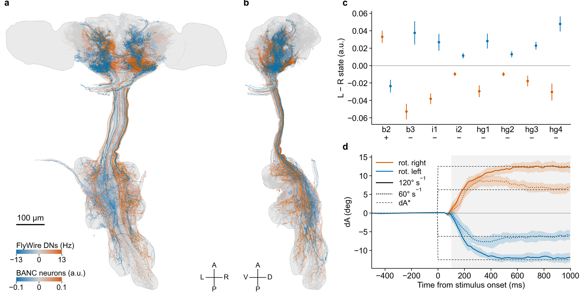
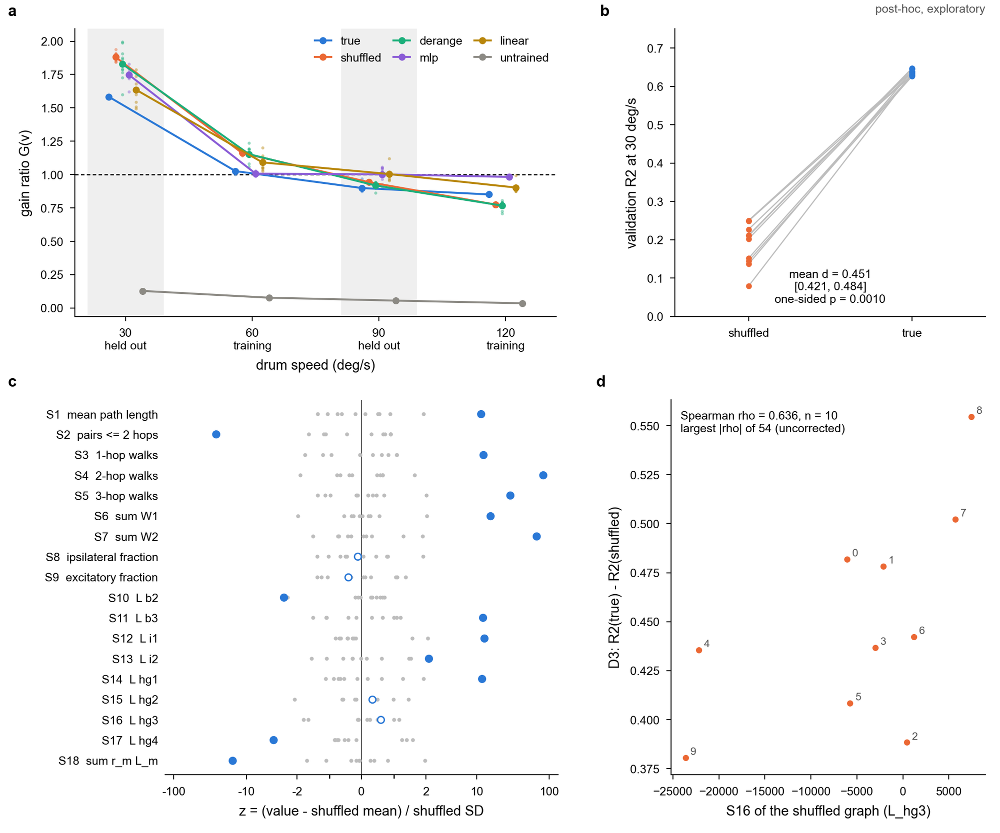
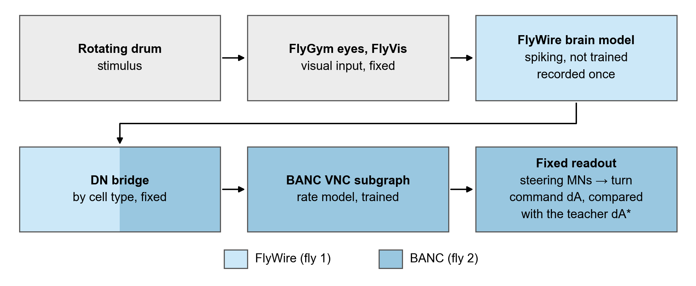
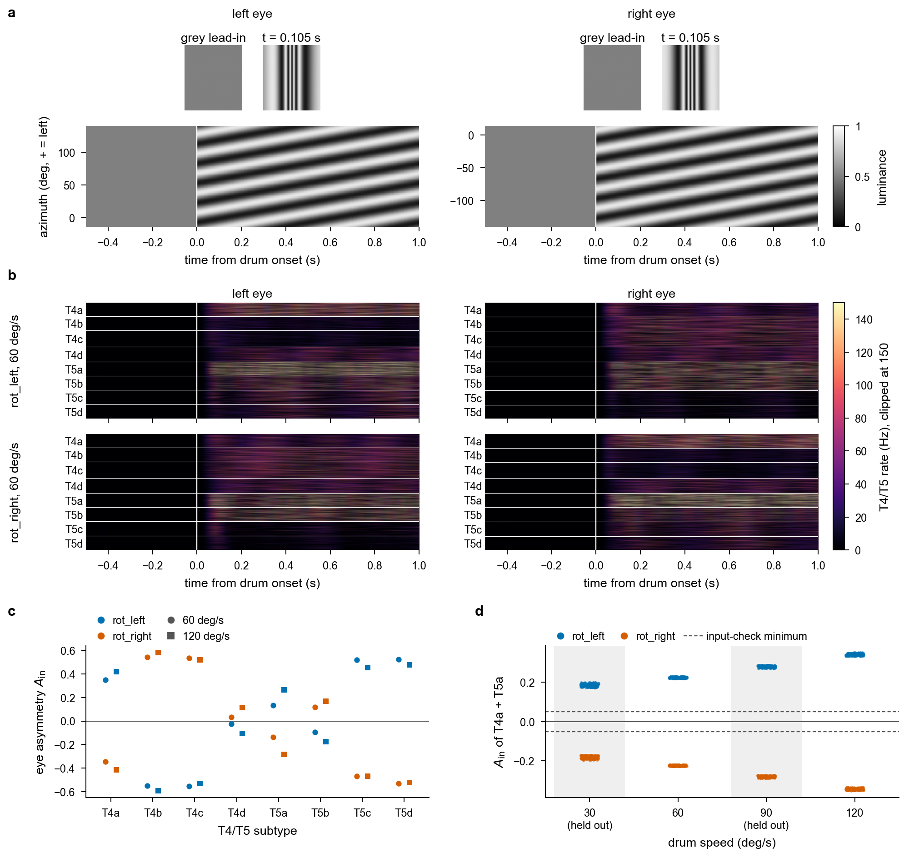
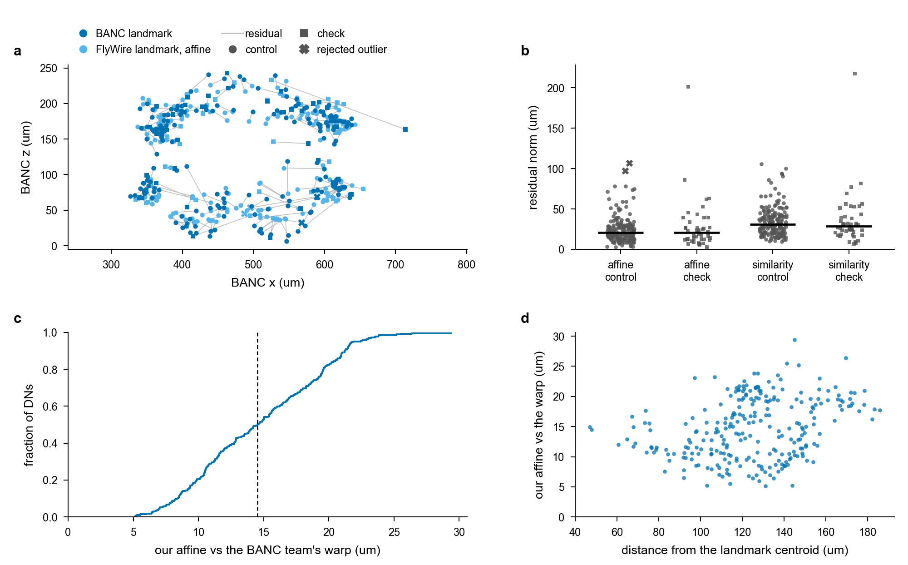
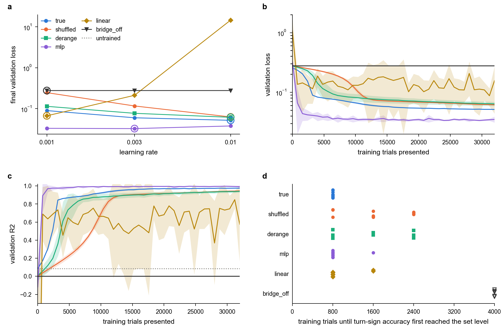

# synaptera-banc-brain

A simulation test of whether the real wiring of a BANC v888 ventral nerve cord (VNC) subgraph, driven by a FlyWire v783 brain model through a descending-neuron (DN) bridge, helps it learn a steering readout better than the same subgraph with degree-preserving shuffled wiring.

Ömer Faruk Topal · [github.com/omeruk](https://github.com/omeruk)

**Contents:** [Result in brief](#result-in-brief) · [The stage-A circuit](#the-stage-a-circuit) · [Activity on the circuit](#activity-on-the-circuit) · [Post-hoc analyses](#post-hoc-analyses) · [How we got here (F0-F3)](#how-we-got-here-f0-f3) · [Key numbers](#key-numbers) · [How it works](#how-it-works) · [What the fly sees](#what-the-fly-sees) · [Joining two flies: cell types and coordinates](#joining-two-flies-cell-types-and-coordinates) · [Training](#training) · [Methods and safeguards](#methods-and-safeguards) · [Limitations](#limitations) · [Reproduce](#reproduce) · [Repository layout](#repository-layout) · [Data, credits and licences](#data-credits-and-licences) · [Authorship](#authorship) · [How to cite](#how-to-cite)



*Direction preference of the stage-A circuit: per neuron, the trial-mean activity for rightward minus leftward drum rotation at 120 deg/s (orange prefers rightward, blue leftward), with the turn command dA for both directions below; validation data seeds 160-199, slowed 10x, open loop (the fly does not turn).*

## Result in brief

The pre-registered stage-A verdict is "The connectome helps in stage A" (final). In plain words: on the sealed test split, the VNC subgraph trained with its real wiring (`true`) reached a higher test R2 at the training speeds than the same subgraph with degree-preserving shuffled wiring (`shuffled`), in all 10 training seeds. R2 is 1 - SSE / SST of the window-mean turn command dA against the teacher dA*; d is the per-seed difference R2(`true`) - R2(`shuffled`). Mean d was 0.0268 (95 % bootstrap interval 0.0242 to 0.0291), one-sided exact sign-flip p = 0.0010 (1/1024), Holm-adjusted p = 0.0029 (stages B and C were not run and count as p = 1).

Context. An unconstrained two-layer network (`mlp`) had a higher test R2 than `true` at the training speeds. At the held-out 90 deg/s, `shuffled` and `mlp` had a higher test R2 than `true`. At the held-out 30 deg/s, `true` had the highest test R2 of all 7 arms. On the validation data seeds the 30 deg/s advantage was found again (post-hoc, exploratory: mean d 0.451, one-sided p = 1/1024); it used the same trained networks on new trials, so it is not an independent replication of training.



**Figure 1 | On the test split, `true` reached a higher R2 than `shuffled` at the training speeds; `mlp` was higher still, and at 30 deg/s `true` was highest.** a, Test R2 at the training speeds (60 and 120 deg/s) of `true` and `shuffled` per training seed; grey lines join the two runs of a seed, bars are arm means. b, Test R2 at the training speeds of the five trained comparison arms, one dot per training seed (horizontal jitter only), bars are arm means; `bridge_off` and `untrained` lie far below this axis (values in [Key numbers](#key-numbers)). c, Test R2 per condition: the training speeds, 90 deg/s and 30 deg/s (both held out, grey bands); large markers are arm means, small dots single runs; colours and marker shapes as in the legend, the same colours as Figure 4. Test split, data seeds 200-239: per run 240 trials at the training speeds and 80 rotation trials per held-out speed; 10 training seeds per trained arm, 5 for `bridge_off`, 1 `untrained` run.

## The stage-A circuit



**Figure 2 | The stage-A circuit in BANC space, from the FlyWire DNs that drive the model to the steering motor neurons it reads out.** a-d, Frontal (a), dorsal (b), lateral from the left (c) and posterior (d) views at one scale. Sky blue, the 321 FlyWire descending neurons (DNs) that drive the model; blue, the 305 BANC DNs that receive their input; orange, 150 VNC interneurons on the strongest two-hop paths to the steering motor neurons; vermillion, the 16 wing steering motor neurons (MNs) of the readout; grey, brain and VNC neuropil. FlyWire DNs (brain) and BANC DNs (cord) of the same types meet at the neck, where the model's DN bridge joins them. D/V, L/R, A/P: dorsal/ventral, left/right, anterior/posterior. Scale bar, 100 µm. Anatomy only; a demonstration figure.

## Activity on the circuit



**Figure 3 | Direction preference of every drawn neuron of the trained circuit, and the turn command it produced, on validation trials.** a, b, Dorsal (a) and lateral (b) views; each neuron is coloured by its mean window activity for rightward minus leftward rotation (orange, rightward preferred; blue, leftward), strongest on top. FlyWire DNs in Hz, from the untrained spiking reference brain; BANC DNs, VNC interneurons and steering MNs in units of the nerve-cord rate model (`true`, training seed 0), the only part trained in stage A; the colour bars give the ranges. c, Left-minus-right state per steering-MN type and direction (orange rightward, blue leftward), mean ± s.d.; +/-, readout sign. d, Turn command dA (deg) over time from stimulus onset (ms) per direction and speed (solid 120, dotted 60 deg/s), mean ± s.d.; dashed, the teacher dA*; shading, the analysis window. Validation split, data seeds 160-199 (40 seeds) at 60 and 120 deg/s: 160 rotation trials.

## Post-hoc analyses

These analyses were planned after the test result (prereg/21, committed before they were computed) and are exploratory; none of them enters a verdict.



**Figure 4 | Post-hoc, exploratory: on the validation data seeds `true` kept its advantage at 30 deg/s, and its graph lay outside the range of the shuffles on 14 of 18 structure measures.** a, Speed tuning: gain ratio G(v) = mean sign(dA*) dA / (K_P v) of the window-mean output against drum speed, per arm; lines, means over the training seeds; small dots, single seeds; `untrained`, one run; dashed line, the teacher (G = 1); the held-out speeds are shaded. b, Validation R2 at 30 deg/s, `true` against `shuffled` per training seed (lines pair the seeds), with the primary post-hoc test in the panel. c, Structure of the `true` VNC graph against the shuffled graphs: per measure S1-S18 ([definitions](docs/results/f5_stageA_posthoc.md)), z = (value - shuffled mean) / shuffled SD; grey, the shuffled graphs; blue, `true` (filled where it lies outside the shuffled range); symmetric-log axis. d, The strongest structure-deficit correlation, selected as the largest |rho| of 54 uncorrected Spearman correlations, none of which reached |rho| >= 0.648 (the two-sided 5 % level at n = 10): S16 (signed lateral influence index L_hg3) of each training seed's shuffled graph against D3, the validation 30 deg/s deficit R2(`true`) - R2(`shuffled`); numbers, the training seeds. Validation split, data seeds 160-199, 80 rotation trials per held-out speed and run; post-hoc and exploratory.

All supporting figures (test split, validation and learning-rate selection, stimulus and visual input, video stills, alignment): [docs/FIGURES.md](docs/FIGURES.md).

## How we got here (F0-F3)

Synaptera v1 ([github.com/omeruk/synaptera](https://github.com/omeruk/synaptera)) flew a fly with a FlyWire brain and a FlyGym body but steered it with hand-made code; this repository hands steering to connectomes, step by step. Each phase has its own report; negative results carry equal weight ([summary of F0-F3](docs/results/SUMMARY_F0_F3.md)).

| phase | question | result | report |
|---|---|---|---|
| F0 | does the ported v1 stack reproduce v1 (FlyWire brain and FlyGym body)? | yes; largest position difference to v1 in the multi-seed acceptance 0.27 mm | [f0_acceptance](docs/results/f0_acceptance.md), [f0_multiseed](docs/results/f0_multiseed.md) |
| F1-F2 | can the BANC whole-brain graph replace the FlyWire brain? | no: with the unchanged reference parameters the feeding motor neuron MN9 did not respond to the labellar sugar input of Shiu et al.'s benchmark (0.0 Hz against 59.7 Hz in FlyWire), and uniform w_syn scaling ignited the network first; so the hybrid keeps the FlyWire brain | [f1_banc_smoke](docs/results/f1_banc_smoke.md), [f2_full_graph](docs/results/f2_full_graph.md), [f2_wsyn_calibration](docs/results/f2_wsyn_calibration.md) |
| F3 prep | which DN families are shared by name and pass the symmetry gate? | 112 of 348 shared families pass in both datasets | [f3_dn_crosswalk](docs/results/f3_dn_crosswalk.md) |
| F3a | does the BANC VNC (subgraph) turn DN activity into wing MN activity? | yes for wing power (DLM1-4 53.8 Hz under bilateral DNg02 drive); ipsilateral steering by DNa04, DNa10 and DNa15 in the VNC subgraph | [f3a_banc_vnc](docs/results/f3a_banc_vnc.md), [f3a3_vnc_subgraph](docs/results/f3a3_vnc_subgraph.md) |
| F3b-1 | does a rotating grating reach the VNC through three DN families? | no: three families were too few (highest applied DNa04 rate 6.9 Hz against its lowest steering rate of 25 Hz) | [f3b1_optomotor](docs/results/f3b1_optomotor.md) |
| F3b-2 | does an ensemble of all shared, gate-passing families carry it? | direction-selective, but so is the shuffled control | [f3b2_dn_ensemble](docs/results/f3b2_dn_ensemble.md) |
| F3b-3 | is that specific to the true bridge mapping (fresh brain seeds, permutation test against 39 random derangements)? | the untrained spiking hybrid carried grating direction to steering-MN asymmetry, replicated on fresh seeds and not direction-selective with the bridge off, but not specific to the true mapping: permutation p 0.250 (b3), 0.250 (i1), 0.450 (hg1) and 0.100 (hg4) | [f3b3_specificity](docs/results/f3b3_specificity.md) |
| F5 stage A | with training, does the real VNC wiring help? | yes on the test split (the primary test, [Result in brief](#result-in-brief)) | [f5_stageA_report](docs/results/f5_stageA_report.md) |

Side by side, and without a causal link: in stage A, with a different model (the trained rate VNC) and a different measure (test R2), the true bridge mapping beat `derange` (a secondary comparison) and the real VNC wiring beat `shuffled` (the primary test).

## Key numbers

Test split, mean over training seeds (standard deviations in [docs/results/f5_stageA_report.md](docs/results/f5_stageA_report.md)). R2 at the training speeds is over all trials at those speeds (rotation, static and grey); turn-sign accuracy is over the rotation trials at the training speeds.

| arm | seeds | R2, training speeds | R2, 90 deg/s | R2, 30 deg/s | turn-sign accuracy, training speeds |
|---|---:|---:|---:|---:|---:|
| `true` | 10 | 0.9773 | 0.9838 | 0.6564 | 1.000 |
| `shuffled` | 10 | 0.9504 | 0.9912 | 0.2446 | 1.000 |
| `derange` | 10 | 0.9444 | 0.9836 | 0.2546 | 1.000 |
| `mlp` | 10 | 0.9984 | 0.9924 | 0.4421 | 1.000 |
| `linear` | 10 | 0.9673 | 0.9777 | 0.4158 | 1.000 |
| `bridge_off` | 5 | 0.0000 | 0.0000 | 0.0000 | 0.500 |
| `untrained` | 1 | 0.0833 | 0.1036 | 0.2377 | 1.000 |

## How it works



*Figure 0 | The stage-A pipeline: light blue is FlyWire (fly 1), darker blue BANC (fly 2), grey neither; only the BANC VNC subgraph is trained.*

The brain and the nerve cord come from two different flies and are joined by DN cell type; see [Joining two flies: cell types and coordinates](#joining-two-flies-cell-types-and-coordinates).

- **Stimulus and brain.** A rotating grating (rot_left / rot_right at 30, 60, 90 and 120 deg/s), a static grating and grey were rendered for the FlyGym eyes and passed through FlyVis to a visual boundary layer that drives the FlyWire v783 brain, the unmodified spiking reference model of Shiu et al. Each trial is 300 intervals of 5 ms (100 grey lead-in intervals, then the stimulus). The brain was run once per trial and its DN spike counts recorded; stage A replays these records, so the brain is the same for every arm and is never trained.
- **DN bridge.** The recorded FlyWire DN counts are turned into unit rates (window 5 intervals, latency 1 interval) that clamp the BANC DNs of the same types (BANC DN state = unit rate / 100 Hz). DNg02 is clamped at a fixed baseline; every other BANC DN is 0.
- **VNC subgraph.** A rate model of the BANC VNC subgraph (25,818 neurons, 3,020,333 edges), one update per interval. Trained: a gain per edge and a leak rate per neuron; the topology and the synapse signs are fixed (prereg/14 section 2).
- **Readout (fixed).** dA = 0.395 deg/Hz x 100 Hz x sum over types of sigma (s_left - s_right), one MN per type and side, over the wing steering MN types b2 (sigma +) and b3, i1, i2, hg1, hg2, hg3, hg4 (sigma -) (`LATERAL` in `scripts/f5_train.py`; the types of Lindsay et al., see the references).
- **Teacher and loss.** dA* = K_P v during the stimulus (v = +speed for rot_right, -speed for rot_left; 0 under static, grey and the lead-in), clipped at ±12.5 deg, K_P = 12.5 / 120 deg per deg/s. Loss: the mean over every interval of ((dA - dA*) / 12.5 deg)^2. Metrics use the window mean over intervals 120-299 (the stimulus after its first 100 ms).

Arms (the same data, budget and test for each):

- `true`: the VNC subgraph with its real wiring.
- `shuffled`: the same subgraph rewired by degree-preserving edge swaps; the primary comparison arm.
- `derange`: `true`, with the bridge feeding DN families into the wrong BANC targets.
- `mlp`: an unconstrained two-layer ReLU network from the filtered bridge input to the readout MN states.
- `linear`: one linear map from the same filtered input to the readout MN states.
- `bridge_off`: `true` with every bridged DN clamped to 0: the ablation and leakage check.
- `untrained`: `true` at initialisation, evaluated without training.

<details><summary>Full arm definitions (prereg/14 section 5, prereg/19 sections 2-3)</summary>

- `true`: the graphs of prereg/14 section 2.
- `shuffled`: degree-preserving directed double-edge swaps (a->b, c->d => a->d, c->b; no self-loops, no duplicate pairs), 10 x E successful swaps; the synapse count travels with the edge, the sign with the presynaptic neuron; swap RNG `default_rng(20261501 + t)` for training seed t.
- `derange`: `true`, with the bridge family mapping replaced by the prereg/11 derangement `random_(t+1)`.
- `mlp`: two ReLU hidden layers of equal width h, then a linear map (no output nonlinearity) to the 16 readout MN states and the fixed readout; h is the smallest width with at least the parameter count of `true`. Input: the 225 units of the `true` bridge, each through exponential filters of 10, 25, 50, 100 ms.
- `linear`: one linear map from the same filtered input to the readout MN states, then the fixed readout.
- `bridge_off`: `true` with every bridged DN clamped to 0 (DNg02 kept).
- `untrained`: `true` at initialisation, one deterministic evaluation on the test set.

Training seeds: 10 per trained arm, 5 for `bridge_off`.

</details>

## What the fly sees

The drum is rendered for the two FlyGym eyes and passed through FlyVis, whose boundary layer drives the FlyWire v783 brain. T4 and T5 are the direction-selective motion detectors of the fly optic lobe, T4 for ON (brightening) and T5 for OFF (darkening) edges, each in four subtypes, a to d; FlyVis models them (Lappalainen et al., see the references), and the boundary layer carries their rates per eye. The statements below are measurements; no preferred direction is attributed to any subtype.

In the grey lead-in the mean T4/T5 rate is 0.091 Hz in the left eye and 0.091 Hz in the right; during leftward rotation at 60 deg/s the per-subtype, per-eye means over the stimulus lie between 4.5 and 47.3 Hz. With the input asymmetry `A_in = (L - R) / (L + R + 1)` of the mean left-eye and right-eye rates, leftward rotation gives a positive A_in of T4a + T5a (left eye higher: 0.223 at 60 deg/s, 0.333 at 120 deg/s) and rightward rotation a negative one (-0.225 and -0.341). Per subtype, the asymmetry under rightward rotation is close to the negative of that under leftward rotation: their sum is at most 0.049 in absolute value over the subtypes and both speeds, against single asymmetries of up to 0.59.

Over every training and validation seed group (they differ in grating phase), A_in of T4a + T5a is positive for rot_left and negative for rot_right in every group, and its size grows with drum speed: the rot_left mean rises from 0.185 at 30 deg/s to 0.342 at 120 deg/s. The grating phase hardly changes it: the largest SD over speeds and directions is 0.007. All 804 input checks passed (training, validation and test); for the test split only the pass was kept, not the values.



**Figure 7 | What the fly sees and how its T4/T5 motion detectors respond.** a, Raw images of the left and right FlyGym eye (the grey lead-in and the first stimulus time, t = 0.105 s) and, per eye, the luminance of the middle image row against time from drum onset and azimuth (positive to the left of the fly; the left plot's axis label applies to both); the drum turns as one body, so the stripes have the same slope in both eyes. b, T4/T5 boundary rates of the left and right eye during leftward and rightward rotation at 60 deg/s; rows are neurons grouped by subtype, so each pixel row averages several neurons; the colour scale runs from 0 to the boundary-layer clip of 150 Hz, which 2.2 % of the plotted rates reach. c, Per-subtype A_in at 60 (circles) and 120 deg/s (squares); blue, rot_left; vermillion, rot_right. d, A_in of T4a + T5a of the input check per seed group (161 training and validation seed groups per speed); the held-out speeds 30 and 90 deg/s on the grey band; dashed lines at ±0.05, the input-check minimum. a-c, training data seed 0, grating phase 0 (the renders were re-made and shown identical to the originals); d, every training and validation seed group of `docs/figures/input_checks.csv`. The original previews are Figures S8-S11 in [docs/FIGURES.md](docs/FIGURES.md).

<details><summary>T4/T5 per subtype</summary>

| subtype | neurons, left / right eye | mean rate, rot_left 60 deg/s, left / right eye (Hz) | A_in, rot_left 60 | A_in, rot_right 60 | A_in, rot_left 120 | A_in, rot_right 120 |
|---|---:|---:|---:|---:|---:|---:|
| T4a | 720 / 737 | 40.6 / 19.3 | +0.35 | -0.35 | +0.42 | -0.42 |
| T4b | 759 / 748 | 8.0 / 28.9 | -0.55 | +0.54 | -0.59 | +0.58 |
| T4c | 868 / 842 | 6.8 / 24.9 | -0.55 | +0.54 | -0.53 | +0.52 |
| T4d | 792 / 777 | 20.2 / 21.3 | -0.02 | +0.03 | -0.11 | +0.11 |
| T5a | 740 / 743 | 47.3 / 36.1 | +0.13 | -0.14 | +0.27 | -0.28 |
| T5b | 754 / 760 | 26.6 / 32.2 | -0.09 | +0.12 | -0.17 | +0.17 |
| T5c | 770 / 766 | 18.4 / 5.5 | +0.52 | -0.47 | +0.45 | -0.47 |
| T5d | 742 / 727 | 15.6 / 4.5 | +0.52 | -0.53 | +0.48 | -0.52 |
| all | 6,145 / 6,100 | |  |  |  |  |

Mean rates and A_in over the whole stimulus (the input-check window of `scripts/f3b1_common.py`), training data seed 0, grating phase 0; `docs/figures/visual_input.json`.

</details>

<details><summary>The input check over the training data</summary>

| speed (deg/s) | held out? | seed groups (train + val) | A_in rot_left, mean ± SD (min) | A_in rot_right, mean ± SD (max) |
|---:|---|---:|---:|---:|
| 30 | yes | 161 | 0.185 ± 0.007 (0.174) | -0.182 ± 0.007 (-0.170) |
| 60 | no | 161 | 0.224 ± 0.003 (0.220) | -0.223 ± 0.002 (-0.220) |
| 90 | yes | 161 | 0.280 ± 0.004 (0.272) | -0.281 ± 0.004 (-0.273) |
| 120 | no | 161 | 0.342 ± 0.005 (0.333) | -0.343 ± 0.004 (-0.334) |

A_in of T4a + T5a over the whole stimulus, one value per seed group and direction (prereg/09 input check: it passes when rot_left and rot_right have opposite signs and both are at least the input-check minimum in size); SD, the sample SD over seed groups (`ddof = 1`); min, the smallest rot_left value; max, the largest (least negative) rot_right value. `docs/figures/input_checks.csv`; the test rows carry only the pass.

</details>

## Joining two flies: cell types and coordinates

The model joins the brain and the nerve cord by DN cell type; positions in space are used only for the figures.

**By cell type (the model).** The brain (FlyWire v783) and the brain and nerve cord of BANC (v888) come from two different female flies (`docs/07_HYBRID_INTERFACE.md`), so DNs are matched by type, not by position. FlyWire has 1,299 DNs in 454 type families, BANC 1,316 in 537; 348 families are shared by name, and 112 of them pass the symmetry gate in both datasets. These form the DN bridge (details below).

<details><summary>Matching by cell type: rules and numbers</summary>

- **Matching key:** exact `cell_type` first, then the family (`cell_type` without a single trailing `_<letter>`), else silent; left to left and right to right; centre neurons only to same-name centre neurons (`docs/07_HYBRID_INTERFACE.md`).
- **Shared families:** their neurons number 1,064 in FlyWire and 927 in BANC; 187 shared families have identical left/right counts in both datasets.
- **Symmetry gate:** |log2(R/L)| < 0.5 of the input synapses, total and excitatory, on each dataset's own graph; the bridge uses the shared families that pass it in both datasets.
- **The bridge:** 225 units (221 by exact type, 4 by family; 113 left, 112 right); 305 BANC targets (152 left, 153 right) from 321 FlyWire neurons (prereg/10 section 4).
- **Rate transfer:** per BANC unit, the mean rate per neuron of the matched FlyWire DNs over a trailing window of 25 ms, applied 5 ms later; in the spiking hybrid (F3b) every BANC neuron of the unit receives an independent Poisson process at that rate; in the stage-A rate model the BANC DN state is the rate / 100 Hz.
- **Unmatched DNs:** unmatched BANC DNs are silent; unmatched FlyWire DNs are dropped.
- **Coverage gap:** 386 BANC DN families have direct synapses onto wing, haltere, neck or TTMn motor neurons; 132 of them have no FlyWire family of the same name, and 85 are shared and pass the gate in both datasets.
- **DNg02:** it fails the gate in FlyWire (log2(R/L) of the total input synapses +0.58) and passes in BANC, and it is silent in the FlyWire brain model; in the hybrid it is a fixed `HAND` baseline ([summary of F0-F3](docs/results/SUMMARY_F0_F3.md)).
- **Controls on the mapping:** in F3b-2 a single random cycle over the shared, gate-passing families (a derangement, drawn with Sattolo's algorithm, `default_rng(20261013)`, side kept); in F3b-3 39 random derangements; in stage A the `derange` arm: the same rate streams and targets with the family mapping deranged (224 units).
- **Motor-neuron sides** were audited against their exit nerves ([Methods and safeguards](#methods-and-safeguards)).

</details>

**In space (the figures).** For the figures only, FlyWire positions were mapped into BANC space. Our own transform, an affine fitted to DN-type landmarks, is a visualisation scaffold for viewing only (`scripts/viz_positions.py`) and includes a reflection. The anatomy figure, the activity figure and the video do not use it: they draw the BANC team's warped FlyWire skeletons (FAFB14 -> JRC2018F -> mirror -> BANC, elastix + thin-plate spline) and BANC skeletons. Our affine places the brain-model positions of Figure S15 and is compared with the BANC team's warp in Figure 6. None of this enters the model.



**Figure 6 | Our FlyWire -> BANC affine, used only for the figures, against its landmarks and against the BANC team's warp.** a, The landmarks in BANC coordinates on the two axes with the largest spread of the BANC landmarks (x and z): BANC landmark points (blue), FlyWire landmark points after our affine (sky blue) and a grey line per landmark for its residual; circles, control; squares, check; crosses, the rejected outliers. This is a 2-D view of 3-D residuals. b, Residual norms (µm) of the affine and the similarity for the control points (crosses, the affine's rejected outliers) and the check points; bars, medians. c, Distance between our affine-placed FlyWire soma and the root node of the BANC team's warped skeleton, as a cumulative distribution over the DNs used; dashed, the median. d, The same distance against the distance of the warped root from the centroid of the fitted landmarks. 221 landmarks (177 control, 44 check); c and d, 264 DNs.

<details><summary>Positions, landmarks, the two transforms and the check against the warp</summary>

- **Positions:** FlyWire brain-model neurons at their soma (voxels x (4, 4, 40) nm) where present (118,078 of 138,639), else at the centroid of their synapses (16,492) or a fallback centroid (4,069); BANC VNC neurons at their root position (24,950), else at the synapse-weighted mean position of their partners (865), else dropped (3).
- **Landmarks:** one per bridged DN type and side matched by exact type (family matches are not used): the FlyWire mean soma against the BANC mean root position of the type's neurons with a nucleus id, as type means (neurons within a type have no one-to-one match); 111 types, none dropped.
- **Hold-out:** 20 % of the landmark types, both sides together (`default_rng(0)`), are check points: 22 types.
- **Fit:** least squares on the control points, refitted after rejecting every point whose residual exceeds 3 x the RMSE of the kept points, until none is rejected; the affine rejected DNge024 (left) and DNg111 (left), the similarity none.

| | affine | similarity |
|---|---:|---:|
| parameters | 12 | 7 |
| RMSE, control points (µm) | 28.2 | 39.0 |
| RMSE, check points (µm) | 42.3 | 48.9 |
| outliers removed | 2 | 0 |
| determinant | -0.832 | -0.921 |
| scale | 0.941 | 0.973 |
| side check, left DNs | 0.961 | 0.991 |
| side check, right DNs | 0.974 | 0.975 |

Side check: the fraction of the FlyWire left (645) and right (646) DNs that land on the same BANC side, by the majority label of the 15 nearest BANC neurons with a nucleus id.
- **Reflection:** both determinants are negative, so both maps include a mirror image (this follows from the definition of the determinant); this is consistent with the mirror step of the BANC team's pipeline named in `docs/figures/warp_check.json`.
- **Unit check of the native skeletons:** read in nm (not voxels), the native skeleton's root lies within 5 µm of the FlyWire soma for 320 DNs (median root-soma distance 0.41 µm).
- **Excluded:** 56 DNs (42 types): their warped file is another skeleton than the native one, so its root is not the soma.
- **Our affine against the warp,** over the DNs used: median 14.5 µm, RMSE 15.5 µm, 95th percentile 21.9 µm, maximum 29.4 µm; median by landmark set: control 13.5 µm (n = 198), rejected outliers 10.5 µm (n = 4), check 17.6 µm (n = 51), no landmark 15.4 µm (n = 11); mean signed difference x +1.51, y -0.78, z +0.33 µm.
- **Distance dependence, as measured:** Spearman rho 0.29 (p = 1.9e-06) between the error and the distance from the landmark centroid; slope 0.057 µm of error per µm of distance; median error by distance third, nearest to farthest: 11.6, 17.1 and 15.8 µm.
- **Verified:** `scripts/verify_report.py` (`check_alignment`) refits both transforms from the committed landmarks on every run and reproduces the stored matrices, the rejected outliers and the hold-out. The side check is the one value it cannot recompute: it needs the BANC neuron table and the position of every FlyWire DN, which are not committed.
- **Which positions each figure uses:** Figure 2 (`scripts/viz_anatomy.py`, `load_circuit_lines`), Figure 3 (`scripts/viz_activity_figure.py`, `circuit_lines`) and the video and GIF (`scripts/viz_video.py`, through `circuit_lines`) draw the BANC team's warped FlyWire skeletons (`fafb_banc`) and BANC skeletons (`banc`); our affine places the brain-model positions of Figure S15 (`scripts/viz_preview.py`) and is compared with the warp in Figure 6 (`check` step of `scripts/viz_anatomy.py`).

</details>

## Training

Stage A trains only the nerve cord. The brain is fixed: its DN spike counts were recorded once and are replayed through the bridge. The rate model of the BANC VNC subgraph learns a gain per edge and a leak rate per neuron, each within fixed bounds (prereg/14 section 2), so the wiring itself, topology and synapse signs, never changes: the comparison asks whether the real wiring is a better substrate for learning the turn command than the same neurons with shuffled wiring. Every arm gets the same data, budget, learning-rate selection rule and test (H1, prereg/14 section 1).

The curriculum (prereg/14 section 3):

| stage | trained part | input | task | status |
|---|---|---|---|---|
| A | rate BANC VNC subgraph | recorded FlyWire DN spike counts (spiking reference brain R) through the bridge | open-loop dA | run |
| B | rate FlyWire brain + rate VNC (VNC warm-started from A, same arm and training seed) | frozen FlyVis 1.2.0 -> boundary layer | open-loop dA | not run |
| C | as B, warm-started from B | online frozen FlyVis in the docs/08 closed loop | behaviour cloning, then 5 DAgger rounds (beta = 0) | not run |
| D | optional | - | needs its own pre-registration before any D run; never part of the section 8 verdict | optional, not run |

What was trained:

- **The graph:** 25,818 neurons, 3,020,333 edges and 3,044,835 trainable parameters, one gain per edge and one leak rate per neuron; the 1,316 clamped DN inputs have no leak rate.
- **Fair controls:** `mlp` has 3,047,360 parameters (width 1,346, the smallest with at least the parameter count of `true`, prereg/14 section 5); `linear` has 14,416; `shuffled` keeps every neuron's in- and out-degree, and every edge keeps its synapse count and presynaptic sign.
- **The same input for every arm:** the brain was recorded once, 2,400 records, with 804 of 804 input checks passed, and the gate-5 check reproduced a reference record bit for bit (prereg/14 gate 5).

<details><summary>How it was trained</summary>

- **Data:** 960 training and 240 validation trials (rot_left / rot_right at 60 and 120 deg/s, static and grey); data seeds: training 0-159, validation 160-199, test 200-239.
- **Optimiser and budget:** Adam, batch 16, 2,000 steps, so 32,000 training trials presented per run.
- **Evaluation and checkpoint:** the full validation set every 50 steps; the checkpoint with the lowest validation loss is kept (prereg/14 section 6).
- **Learning rate:** the grid {0.001, 0.003, 0.01}; per arm, the rate with the lowest final validation loss at training seed 0 is used for every seed.
- **Training seeds:** 10 per trained arm, 5 for `bridge_off`.
- **Memory:** a sparse edge gradient (sddmm, prereg/18), so the full graph trains on an 8 GiB laptop GPU; the smoke run peaked at 1.2 GiB of GPU memory.
- **One GPU job at a time,** through a guard (`scripts/f5_train_guard.py`) with GPU memory capped at a fraction 0.7, a RAM cap of MemoryMax=14G, no swap (systemd scope) and a pause at a GPU temperature of 87 °C. This followed the parallel benchmark, which ended in a driver fault (5,043 nvlddmkm events and an unexpected shutdown; `docs/results/f5_benchmark.json`, incident).
- **Guard record:** 76 of 77 jobs ended normally; 6 pauses, all for GPU temperature; from 2026-10-18 18:39:32 to 2026-10-19 19:06:39. After a pause a run resumes from its latest checkpoint (written every 25 steps).
- **Replicate (prereg/19):** `true` at seed 0 and its selected rate, trained a second time, agreed with the first run at every evaluation to 8.0e-09 in validation loss and 4.7e-08 in R2, with equal turn-sign accuracy.
- **Test:** once per run, on the CPU, from the selected checkpoint (see [Methods and safeguards](#methods-and-safeguards)).

</details>

What happened (validation split, descriptive):

- **Selected learning rates:** `true` 0.01, `shuffled` 0.01, `derange` 0.01, `mlp` 0.003, `linear` 0.001, `bridge_off` 0.001.



**Figure 5 | Stage-A training on the validation split: learning-rate selection, learning curves and the trials to the set turn-sign accuracy.** a, Learning-rate selection at training seed 0: final validation loss per arm and learning rate (log scale); circles mark the selected rate. b, Validation loss over training trials presented at the selected rate (log scale); lines, means over training seeds; bands, ± 1 SD (cut at the axis where they fall below it). c, Validation R2 of the window mean, same layout; dotted, `untrained` (one evaluation at initialisation); the `linear` mean leaves the axis at some evaluations (its R2 swings widely; prereg/20 limitation c). d, Training trials until the validation turn-sign accuracy first reached 0.90, one marker per training seed (vertical jitter only); ticks at the evaluation interval (800 trials); open markers at the right edge, later than the axis end or never (`bridge_off` never). Validation split, data seeds 160-199 (240 trials per evaluation); 10 training seeds per arm, 5 for `bridge_off`.

- **Training trials to the set turn-sign accuracy** (mean over seeds): `true` 800, `shuffled` 1,600, `derange` 1,600, `mlp` 880, `linear` 960; `bridge_off` never (5 of 5 seeds). `true` reached it at the first evaluation in every seed. The evaluation interval limits the resolution, and turn-sign accuracy is near ceiling (prereg/20 limitation b).
- **Registered secondary comparison** of samples to set accuracy, `true` against `shuffled` (prereg/14 section 8.3: counted on the validation evaluations during training, compared in the test report; no Holm, never a verdict): in favour of `true`, one-sided p = 0.0078 (8/1024).
- `mlp` reached the lowest validation loss (selected checkpoints, mean 0.0325).
- The `shuffled` validation loss was still falling at the end of the budget (prereg/20 limitation a; see [Limitations](#limitations)).

## Methods and safeguards

- **Pre-registration.** The hypotheses, model, arms, budget, metrics, primary test and verdict rules were committed before any stage-A code or run (prereg/14); the addenda prereg/15-20 were committed before the runs or the test evaluation they concern, and prereg/21 fixed the post-hoc analyses before they were computed.
- **Sealed test split.** The test data seeds (200-239) are listed in `configs/f5_splits.json`; only `final-eval` may read them. Each run was evaluated once, on the CPU (8 threads, deterministic) from its selected checkpoint; a `test.lock` file is created before the evaluation, so a second one is refused.
- **Primary test.** One-sided exact paired sign-flip test of mean d over all 1024 sign patterns, Holm-adjusted over stages A, B and C.
- **Guards.** Ceiling: the verdict is qualified if both `true` and `shuffled` have mean test R2 >= 0.98 (not triggered). Leakage: the verdict is withheld if `bridge_off` has a mean test turn-sign accuracy outside the binomial 95 % interval around chance (0.425-0.575 for 160 rotation trials); it was 0.5 (not triggered).
- **Controls.** The arms above: a shuffled graph, a deranged bridge, an ablation, two unconstrained networks and the untrained model.
- **Reproducibility.** Training ran on the GPU, where runs agree only to float32 rounding (prereg/19); the test numbers come from the CPU evaluation and are exactly reproducible from the saved checkpoints.
- **Every number recomputed.** `scripts/verify_report.py` recomputes the numbers of the result reports from the records and checks them against the text.
- **Rate model against the spiking VNC.** Before training, the rate model was checked against the spiking LIF VNC on the F3a-3 protocol (prereg/15): qualitative agreement, with power recruitment agreeing in 8 of 8 items and the steering sign in 27 of 27.
- **Motor-neuron sides audited.** The side of every motor neuron was audited against its exit nerve (prereg/13): 7 readout types of the earlier F3 analyses were relabelled (ADNM1, ADNM2, CvN6, CvN7, CvN9, DLM5, PSI); the post-audit recomputation swapped ADNM2, CvN6, CvN9, DLM5, PSI and could not recompute ADNM1, CvN7. None of the 8 stage-A readout types is in the relabelled list.
- **Errata, not edits.** Factual errors in pre-registration texts are corrected in an errata file, never by editing the pre-registration ([prereg/errata_01_post_hoc.md](prereg/errata_01_post_hoc.md)).

<details><summary>Pre-registrations of stage A</summary>

- [`14_f5_training.md`](prereg/14_f5_training.md): Pre-registration 14 — F5 training: optomotor yaw, curriculum A-C (D optional), connectome against controls
- [`15_f5_rate_lif_comparison.md`](prereg/15_f5_rate_lif_comparison.md): Pre-registration 15 — F5 step 2a: the untrained rate VNC against the LIF VNC on the F3a-3 protocol
- [`16_f5_reachability.md`](prereg/16_f5_reachability.md): Pre-registration 16 — F5 step 2a-2: can the bounded rate VNC reach the target turn amplitude?
- [`17_f5_records_machine2.md`](prereg/17_f5_records_machine2.md): Pre-registration 17 — addendum to prereg/14: F5 stage-A records on machine 2
- [`18_f5_sddmm_checkpointing.md`](prereg/18_f5_sddmm_checkpointing.md): Pre-registration 18 — addendum to prereg/14: edge gradient and gradient checkpointing of F5 training
- [`19_f5_gpu_reproducibility_bridge_units_readout.md`](prereg/19_f5_gpu_reproducibility_bridge_units_readout.md): Pre-registration 19 — addendum to prereg/14: GPU reproducibility, bridge units, mlp / linear output
- [`20_f5_stageA_limitations_exploratory.md`](prereg/20_f5_stageA_limitations_exploratory.md): Pre-registration 20 — addendum to prereg/14: stage-A limitations, an exploratory follow-up, and hardware
- [`21_f5_stageA_posthoc_plan.md`](prereg/21_f5_stageA_posthoc_plan.md): Plan 21: post-hoc analyses of stage A (speed generalisation and structure)

</details>

## Limitations

Recorded in prereg/20 section 1 before the test was unsealed:

- a. Budget and learning rate: `true` and `shuffled` both selected the largest learning rate of the grid, and the `shuffled` validation loss was still falling at the end of the budget, so d may partly reflect learning speed.
- b. Turn-sign accuracy is at ceiling, so it separates the arms little.
- c. `linear` was unstable at every learning rate; its values are noisy.
- d. The `mlp` learning-rate choice was a near tie.
- e. `true` was close to the ceiling guard on the validation split.

Further:

- Stages B and C (trained brain, then closed loop) were not run, so no closed-loop behaviour was tested; the prereg/20 exploratory follow-up (longer training, a larger learning rate) was not run either.
- The post-hoc results (Figure 4) are exploratory.
- The `untrained` arm already had a test turn-sign accuracy of 1.000, so turn-sign accuracy does not separate the arms; R2, which also scores the size of the turn, is the primary metric.
- The readout uses only the 8 MN types named above, one neuron per type and side.
- The model was not compared with neural or behavioural recordings from flies.
- The brain and the nerve cord come from two different flies; the bridge assumes that DNs of the same type carry the same signal in both, which was not tested, and only DN types shared by name and passing the symmetry gate are bridged.
- Wing power comes from a fixed, hand-set DNg02 baseline, because DNg02 is silent in the FlyWire brain model; steering is the only part driven by the brain.
- Everything here is a simulation: open loop, one steering task (optomotor yaw), stage A only.

## Reproduce

<details><summary>Environment, data and commands</summary>

- **Environment.** `bash env/create_neurofly.sh` builds the conda environment `neurofly` (x86_64 Linux) from `env/neurofly_x86_64.yml`. Run every command with `env -u PYTHONPATH` in that environment.
- **External data.** The brain model, the FlyWire and BANC tables and the BANC edge lists are listed with their origin and SHA-256 in `configs/data_sources.yaml`; they are never committed (`banc/`, `brain_model/`, `data/`). The download script `scripts/fetch_data.py` named in `CLAUDE.md` has not been carried over to this repository yet (`MIGRATION_CHECKLIST.md`, item 31), so the files have to be fetched from the origins listed there. Steps 1-5 need them, and so do most checks of `scripts/verify_report.py`, which recompute from the records in `runs/` (not committed); step 6 reads only committed files.
- **Hardware used** (as recorded in `docs/results/f5_benchmark.json`): CPU AMD Ryzen 9 8945HS w/ Radeon 780M Graphics; GPU NVIDIA GeForce RTX 4070 Laptop GPU; WSL2.

1. Stage-A brain records (CPU):

```
env -u PYTHONPATH CUDA_VISIBLE_DEVICES= python scripts/f5_stageA_records.py run --render-workers N --brain-workers M
env -u PYTHONPATH python scripts/f5_stageA_records.py manifest
```

2. Setup and gates (parts: records shuffle engine causality resume alignment_bridge alignment_flyvis symmetry flyvis_render summary):

```
env -u PYTHONPATH python scripts/f5_train.py setup
env -u PYTHONPATH python scripts/f5_train.py gates --part records
```

3. Training on the GPU, through the guard (one GPU job at a time): the learning-rate grid at training seed 0 for each arm, the rate selection, then the other seeds and the replicate:

```
env -u PYTHONPATH python scripts/f5_train_guard.py --log runs/f5/A/guard.log -- \
    python scripts/f5_train.py run --arm true --seed 0 --lr 1e-3
env -u PYTHONPATH python scripts/f5_train.py select-lr --arm true
env -u PYTHONPATH python scripts/f5_train.py run --arm true --seed 3
env -u PYTHONPATH python scripts/f5_train.py run --arm true --seed 0 --replicate
```

4. The test evaluation, once per run, on the CPU (the only reader of the test seeds):

```
env -u PYTHONPATH CUDA_VISIBLE_DEVICES= python scripts/f5_train.py final-eval --arm true --seed 3
```

5. Reports and the post-hoc analyses:

```
env -u PYTHONPATH python scripts/f5_stageA_validation.py
env -u PYTHONPATH python scripts/f5_stageA_report.py
env -u PYTHONPATH CUDA_VISIBLE_DEVICES= python scripts/f5_stageA_posthoc.py predict
env -u PYTHONPATH python scripts/f5_stageA_posthoc.py report
env -u PYTHONPATH python scripts/f5_stageA_posthoc.py figure
```

6. Figure 1 and this README (they read only committed JSON files):

```
env -u PYTHONPATH python scripts/readme_figures.py
env -u PYTHONPATH python scripts/readme_text.py
```

7. Checks:

```
env -u PYTHONPATH python scripts/verify_report.py
PYTEST_DISABLE_PLUGIN_AUTOLOAD=1 env -u PYTHONPATH python -m pytest tests/
```

</details>

## Repository layout

<details><summary>Top-level folders</summary>

- `body/`: Body and physics: arena, quasi-steady wing model, FlyGym body, physical noise.
- `configs/`: configuration files, the data sources (`data_sources.yaml`), the parameter registry (`assumptions.json`) and the data splits (`f5_splits.json`).
- `connectome/`: Connectome data layer: common schema, dataset adapters, homolog/crosswalk selection, sign rules.
- `coupling/`: Coupling of the neural engine and the body: causal command queue, recording, replay.
- `docs/`: design documents; `docs/results/` (result reports), `docs/figures/` (figures and their record), `docs/provenance/` (the Synaptera v1 provenance record).
- `engine/`: Neural engines behind one protocol (docs/05_ARCHITECTURE_PLAN.md section 3.1).
- `env/`: the conda environment and the script that builds it.
- `motor/`: Motor interfaces: readouts, the hand-made bridge and reflexes (control arms).
- `prereg/`: the pre-registrations, never edited after commit.
- `scripts/`: run, report, figure and verification scripts.
- `sense/`: Sensory interfaces: FlyVis vision and its boundary layer, stimuli, gaze / odour / surface sensors.
- `tasks/`: Task ladder: open-loop stimuli, tasks and criteria.
- `tests/`: the test suite.
- `train/`: the stage-A training code, the gates, graph shuffles and checkpoints.
- Not committed: `banc/`, `brain_model/`, `data/` (external data) and `runs/` (run outputs).

</details>

## Data, credits and licences

- **Code:** MIT ([LICENSE](LICENSE)).
- **Data:** FlyWire v783 data are CC BY-NC 4.0; BANC v888 data are CC BY 4.0 and need their attribution. Neither is redistributed here.
- **Figures:** CC BY-NC 4.0, because they contain FlyWire-derived content; per-figure credits, sources and hashes in [docs/figures/README.md](docs/figures/README.md).
- **Third-party software and its licences:** [docs/provenance/synaptera_v1_NOTICE.md](docs/provenance/synaptera_v1_NOTICE.md).

Works this repository uses:

- FlyWire connectome: Dorkenwald, S. et al. (2024). *Nature* 634, 124–138. doi:[10.1038/s41586-024-07558-y](https://doi.org/10.1038/s41586-024-07558-y)
- FlyWire annotations: Schlegel, P. et al. (2024). *Nature* 634, 139–152. doi:[10.1038/s41586-024-07686-5](https://doi.org/10.1038/s41586-024-07686-5)
- FAFB electron-microscopy volume: Zheng, Z. et al. (2018). *Cell* 174, 730–743.e22. doi:[10.1016/j.cell.2018.06.019](https://doi.org/10.1016/j.cell.2018.06.019)
- FlyWire transmitter predictions (synapse signs): Eckstein, N. et al. (2024). *Cell* 187, 2574–2594. doi:[10.1016/j.cell.2024.03.016](https://doi.org/10.1016/j.cell.2024.03.016)
- BANC connectome: Bates, A. S. et al. (2026). *Nature* 656, 957–970. doi:[10.1038/s41586-026-10735-w](https://doi.org/10.1038/s41586-026-10735-w); data: Harvard Dataverse doi:[10.7910/DVN/7WTH1N](https://doi.org/10.7910/DVN/7WTH1N)
- brain model: Shiu, P. K. et al. (2024). *Nature* 634, 210–219. doi:[10.1038/s41586-024-07763-9](https://doi.org/10.1038/s41586-024-07763-9)
- FlyGym / NeuroMechFly v2 (body, eyes): Wang-Chen, S. et al. (2024). *Nature Methods* 21, 2353–2362. doi:[10.1038/s41592-024-02497-y](https://doi.org/10.1038/s41592-024-02497-y)
- FlyVis (visual network): Lappalainen, J. K. et al. (2024). *Nature* 634, 1132–1140. doi:[10.1038/s41586-024-07939-3](https://doi.org/10.1038/s41586-024-07939-3)
- Brian2 (spiking simulation): Stimberg, M., Brette, R. & Goodman, D. F. M. (2019). *eLife* 8, e47314. doi:[10.7554/eLife.47314](https://doi.org/10.7554/eLife.47314)
- wing steering motor system (readout MN types): Lindsay, T., Sustar, A. & Dickinson, M. (2017). *Current Biology* 27, 345–358. doi:[10.1016/j.cub.2016.12.018](https://doi.org/10.1016/j.cub.2016.12.018)

## Authorship

Ömer Faruk Topal, Department of Geomatics Engineering, Istanbul Technical University.

Designed and directed by Ömer Faruk Topal; implemented with the help of Claude Code (Anthropic).

Contact: https://github.com/omeruk

## How to cite

Cite this repository with the metadata in [CITATION.cff](CITATION.cff) (GitHub shows it as "Cite this repository"), and cite the data and models it uses (above).
