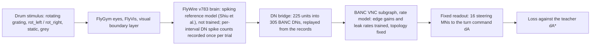

# synaptera-banc-brain

A simulation test of whether the real wiring of a BANC v888 ventral nerve cord (VNC) subgraph, driven by a FlyWire v783 brain model through a descending-neuron (DN) bridge, helps it learn a steering readout better than the same subgraph with degree-preserving shuffled wiring.

Ömer Faruk Topal · [github.com/omeruk](https://github.com/omeruk)

**Contents:** [Result in brief](#result-in-brief) · [The stage-A circuit](#the-stage-a-circuit) · [Activity on the circuit](#activity-on-the-circuit) · [Post-hoc analyses](#post-hoc-analyses) · [Key numbers](#key-numbers) · [How it works](#how-it-works) · [Methods and safeguards](#methods-and-safeguards) · [Limitations](#limitations) · [Reproduce](#reproduce) · [Repository layout](#repository-layout) · [Data, credits and licences](#data-credits-and-licences) · [Authorship](#authorship) · [How to cite](#how-to-cite)


*Direction preference of the stage-A circuit: per neuron, the trial-mean activity for rightward minus leftward drum rotation at 120 deg/s (orange prefers rightward, blue leftward), with the turn command dA for both directions below; validation data seeds 160-199, slowed 10x, open loop (the fly does not turn).*

## Result in brief

The pre-registered stage-A verdict is "The connectome helps in stage A" (final). In plain words: on the sealed test split, the VNC subgraph trained with its real wiring (`true`) reached a higher test R2 at the training speeds than the same subgraph with degree-preserving shuffled wiring (`shuffled`), in all 10 training seeds. R2 is 1 - SSE / SST of the window-mean turn command dA against the teacher dA*; d is the per-seed difference R2(`true`) - R2(`shuffled`). Mean d was 0.0268 (95 % bootstrap interval 0.0242 to 0.0291), one-sided exact sign-flip p = 0.00098 (1/1024), Holm-adjusted p = 0.0029 (stages B and C were not run and count as p = 1).

Context. An unconstrained two-layer network (`mlp`) had a higher test R2 than `true` at the training speeds. At the held-out 90 deg/s, `shuffled` and `mlp` had a higher test R2 than `true`. At the held-out 30 deg/s, `true` had the highest test R2 of all 7 arms. On the validation data seeds the 30 deg/s advantage was found again (post-hoc, exploratory: mean d 0.451, one-sided p = 1/1024); it used the same trained networks on new trials, so it is not an independent replication of training.


**Figure 1 | On the test split, `true` reached a higher R2 than `shuffled` at the training speeds; `mlp` was higher still, and at 30 deg/s `true` was highest.** a, Test R2 at the training speeds (60 and 120 deg/s) of `true` and `shuffled` per training seed; grey lines join the two runs of a seed, bars are arm means. b, Test R2 at the training speeds of the five trained comparison arms, one dot per training seed (horizontal jitter only), bars are arm means; `bridge_off` and `untrained` lie far below this axis (values in [Key numbers](#key-numbers)). c, Test R2 per condition: the training speeds, 90 deg/s and 30 deg/s (both held out, grey bands); large markers are arm means, small dots single runs; colours and marker shapes as in the legend, the same colours as Figure 4. Test split, data seeds 200-239: per run 240 trials at the training speeds and 80 rotation trials per held-out speed; 10 training seeds per trained arm, 5 for `bridge_off`, 1 `untrained` run.

## The stage-A circuit


**Figure 2 | The stage-A circuit in BANC space, from the FlyWire DNs that drive the model to the steering motor neurons it reads out.** a-d, Frontal (a), dorsal (b), lateral from the left (c) and posterior (d) views at one scale. Sky blue, the 321 FlyWire descending neurons (DNs) that drive the model; blue, the 305 BANC DNs that receive their input; orange, 150 VNC interneurons on the strongest two-hop paths to the steering motor neurons; vermillion, the 16 wing steering motor neurons (MNs) of the readout; grey, brain and VNC neuropil. FlyWire DNs (brain) and BANC DNs (cord) of the same types meet at the neck, where the model's DN bridge joins them. D/V, L/R, A/P: dorsal/ventral, left/right, anterior/posterior. Scale bar, 100 µm. Anatomy only; a demonstration figure.

## Activity on the circuit


**Figure 3 | Direction preference of every drawn neuron of the trained circuit, and the turn command it produced, on validation trials.** a, b, Dorsal (a) and lateral (b) views; each neuron is coloured by its mean window activity for rightward minus leftward rotation (orange, rightward preferred; blue, leftward), strongest on top. FlyWire DNs in Hz, from the untrained spiking reference brain; BANC DNs, VNC interneurons and steering MNs in units of the nerve-cord rate model (`true`, training seed 0), the only part trained in stage A; the colour bars give the ranges. c, Left-minus-right state per steering-MN type and direction (orange rightward, blue leftward), mean ± s.d.; +/-, readout sign. d, Turn command dA (deg) over time from stimulus onset (ms) per direction and speed (solid 120, dotted 60 deg/s), mean ± s.d.; dashed, the teacher dA*; shading, the analysis window. Validation split, data seeds 160-199 (40 seeds) at 60 and 120 deg/s: 160 rotation trials.

## Post-hoc analyses

These analyses were planned after the test result (prereg/21, committed before they were computed) and are exploratory; none of them enters a verdict.


**Figure 4 | Post-hoc, exploratory: on the validation data seeds `true` kept its advantage at 30 deg/s, and its graph lay outside the range of the shuffles on 14 of 18 structure measures.** a, Speed tuning: gain ratio G(v) = mean sign(dA*) dA / (K_P v) of the window-mean output against drum speed, per arm; lines, means over the training seeds; small dots, single seeds; `untrained`, one run; dashed line, the teacher (G = 1); the held-out speeds are shaded. b, Validation R2 at 30 deg/s, `true` against `shuffled` per training seed (lines pair the seeds), with the primary post-hoc test in the panel. c, Structure of the `true` VNC graph against the shuffled graphs: per measure S1-S18 ([definitions](docs/results/f5_stageA_posthoc.md)), z = (value - shuffled mean) / shuffled SD; grey, the shuffled graphs; blue, `true` (filled where it lies outside the shuffled range); symmetric-log axis. d, The strongest structure-deficit correlation, selected as the largest |rho| of 54 uncorrected Spearman correlations, none of which reached |rho| >= 0.648 (the two-sided 5 % level at n = 10; 0 reached it): S16 (signed lateral influence index L_hg3) of each training seed's shuffled graph against D3, the validation 30 deg/s deficit R2(`true`) - R2(`shuffled`); numbers, the training seeds. Validation split, data seeds 160-199, 80 rotation trials per held-out speed and run; post-hoc and exploratory.

All supporting figures (test split, validation and learning-rate selection, stimulus and visual input, video stills, alignment): [docs/FIGURES.md](docs/FIGURES.md).

## Key numbers

Test split, mean over training seeds (standard deviations in [docs/results/f5_stageA_report.md](docs/results/f5_stageA_report.md)). R2 at the training speeds is over all trials at those speeds (rotation, static and grey); turn-sign accuracy is over the rotation trials at the training speeds.

| arm | seeds | R2, training speeds | R2, 90 deg/s | R2, 30 deg/s | turn-sign accuracy, training speeds |
|---|---:|---:|---:|---:|---:|
| `true` | 10 | 0.9773 | 0.9838 | 0.6564 | 1.000 |
| `shuffled` | 10 | 0.9504 | 0.9912 | 0.2446 | 1.000 |
| `derange` | 10 | 0.9444 | 0.9836 | 0.2546 | 1.000 |
| `mlp` | 10 | 0.9984 | 0.9924 | 0.4421 | 1.000 |
| `linear` | 10 | 0.9673 | 0.9777 | 0.4158 | 1.000 |
| `bridge_off` | 5 | 0.0000 | 0.0000 | 0.0000 | 0.500 |
| `untrained` | 1 | 0.0833 | 0.1036 | 0.2377 | 1.000 |

## How it works



- **Stimulus and brain.** A rotating grating (rot_left / rot_right at 30, 60, 90 and 120 deg/s), a static grating and grey were rendered for the FlyGym eyes and passed through FlyVis to a visual boundary layer that drives the FlyWire v783 brain, the unmodified spiking reference model of Shiu et al. Each trial is 300 intervals of 5 ms (100 grey lead-in intervals, then the stimulus). The brain was run once per trial and its DN spike counts recorded; stage A replays these records, so the brain is the same for every arm and is never trained.
- **DN bridge.** The recorded FlyWire DN counts are turned into unit rates (window 5 intervals, latency 1 interval) that clamp the BANC DNs of the same types (BANC DN state = unit rate / 100 Hz). DNg02 is clamped at a fixed baseline; every other BANC DN is 0.
- **VNC subgraph.** A rate model of the BANC VNC subgraph (25,818 neurons, 3,020,333 edges), one update per interval. Trained: a gain per edge and a leak rate per neuron; the topology and the synapse signs are fixed (prereg/14 section 2).
- **Readout (fixed).** dA = 0.395 deg/Hz x 100 Hz x sum over types of sigma (s_left - s_right), one MN per type and side, over the wing steering MN types b2 (sigma +) and b3, i1, i2, hg1, hg2, hg3, hg4 (sigma -) (`LATERAL` in `scripts/f5_train.py`; types of Lindsay et al. 2017).
- **Teacher and loss.** dA* = K_P v during the stimulus (v = +speed for rot_right, -speed for rot_left; 0 under static, grey and the lead-in), clipped at ±12.5 deg, K_P = 12.5 / 120 deg per deg/s. Loss: the mean over every interval of ((dA - dA*) / 12.5 deg)^2. Metrics use the window mean over intervals 120-299 (the stimulus after its first 100 ms).
- **Training.** Adam, batch 16, 2,000 steps, the learning rate chosen per arm at training seed 0 from {0.001, 0.003, 0.01} by the lowest final validation loss, and the checkpoint with the lowest validation loss kept. Data seeds: training 0-159, validation 160-199, test 200-239.

Arms (the same data, budget and test for each):

- `true`: the VNC subgraph with its real wiring.
- `shuffled`: the same subgraph rewired by degree-preserving edge swaps; the primary comparison arm.
- `derange`: `true`, with the bridge feeding DN families into the wrong BANC targets.
- `mlp`: an unconstrained two-layer ReLU network from the filtered bridge input to the readout MN states.
- `linear`: one linear map from the same filtered input to the readout MN states.
- `bridge_off`: `true` with every bridged DN clamped to 0: the ablation and leakage check.
- `untrained`: `true` at initialisation, evaluated without training.

<details><summary>Full arm definitions (prereg/14 section 5, prereg/19 sections 2-3)</summary>

- `true`: the graphs of prereg/14 section 2.
- `shuffled`: degree-preserving directed double-edge swaps (a->b, c->d => a->d, c->b; no self-loops, no duplicate pairs), 10 x E successful swaps; the synapse count travels with the edge, the sign with the presynaptic neuron; swap RNG `default_rng(20261501 + t)` for training seed t.
- `derange`: `true`, with the bridge family mapping replaced by the prereg/11 derangement `random_(t+1)`.
- `mlp`: two ReLU hidden layers of equal width h, then a linear map (no output nonlinearity) to the 16 readout MN states and the fixed readout; h is the smallest width with at least the parameter count of `true`. Input: the 225 units of the `true` bridge, each through exponential filters of 10, 25, 50, 100 ms.
- `linear`: one linear map from the same filtered input to the readout MN states, then the fixed readout.
- `bridge_off`: `true` with every bridged DN clamped to 0 (DNg02 kept).
- `untrained`: `true` at initialisation, one deterministic evaluation on the test set.

Training seeds: 10 per trained arm, 5 for `bridge_off`.

</details>

## Methods and safeguards

- **Pre-registration.** The hypotheses, model, arms, budget, metrics, primary test and verdict rules were committed before any stage-A code or run (prereg/14); the addenda prereg/15-20 were committed before the runs or the test evaluation they concern, and prereg/21 fixed the post-hoc analyses before they were computed.
- **Sealed test split.** The test data seeds (200-239) are listed in `configs/f5_splits.json`; only `final-eval` may read them. Each run was evaluated once, on the CPU (8 threads, deterministic) from its selected checkpoint; a `test.lock` file is created before the evaluation, so a second one is refused.
- **Primary test.** One-sided exact paired sign-flip test of mean d over all 1024 sign patterns, Holm-adjusted over stages A, B and C.
- **Guards.** Ceiling: the verdict is qualified if both `true` and `shuffled` have mean test R2 >= 0.98 (not triggered). Leakage: the verdict is withheld if `bridge_off` has a mean test turn-sign accuracy outside the binomial 95 % interval around chance (0.425-0.575 for 160 rotation trials); it was 0.5 (not triggered).
- **Controls.** The arms above: a shuffled graph, a deranged bridge, an ablation, two unconstrained networks and the untrained model.
- **Reproducibility.** Training ran on the GPU, where runs agree only to float32 rounding (prereg/19); the test numbers come from the CPU evaluation and are exactly reproducible from the saved checkpoints.
- **Every number recomputed.** `scripts/verify_report.py` recomputes the numbers of the result reports from the records and checks them against the text.

<details><summary>Pre-registrations of stage A</summary>

- [`14_f5_training.md`](prereg/14_f5_training.md): Pre-registration 14 — F5 training: optomotor yaw, curriculum A-C (D optional), connectome against controls
- [`15_f5_rate_lif_comparison.md`](prereg/15_f5_rate_lif_comparison.md): Pre-registration 15 — F5 step 2a: the untrained rate VNC against the LIF VNC on the F3a-3 protocol
- [`16_f5_reachability.md`](prereg/16_f5_reachability.md): Pre-registration 16 — F5 step 2a-2: can the bounded rate VNC reach the target turn amplitude?
- [`17_f5_records_machine2.md`](prereg/17_f5_records_machine2.md): Pre-registration 17 — addendum to prereg/14: F5 stage-A records on machine 2
- [`18_f5_sddmm_checkpointing.md`](prereg/18_f5_sddmm_checkpointing.md): Pre-registration 18 — addendum to prereg/14: edge gradient and gradient checkpointing of F5 training
- [`19_f5_gpu_reproducibility_bridge_units_readout.md`](prereg/19_f5_gpu_reproducibility_bridge_units_readout.md): Pre-registration 19 — addendum to prereg/14: GPU reproducibility, bridge units, mlp / linear output
- [`20_f5_stageA_limitations_exploratory.md`](prereg/20_f5_stageA_limitations_exploratory.md): Pre-registration 20 — addendum to prereg/14: stage-A limitations, an exploratory follow-up, and hardware
- [`21_f5_stageA_posthoc_plan.md`](prereg/21_f5_stageA_posthoc_plan.md): Plan 21: post-hoc analyses of stage A (speed generalisation and structure)

</details>

## Limitations

Recorded in prereg/20 section 1 before the test was unsealed:

- a. Budget and learning rate: `true` and `shuffled` both selected the largest learning rate of the grid, and the `shuffled` validation loss was still falling at the end of the budget, so d may partly reflect learning speed.
- b. Turn-sign accuracy is at ceiling, so it separates the arms little.
- c. `linear` was unstable at every learning rate; its values are noisy.
- d. The `mlp` learning-rate choice was a near tie.
- e. `true` was close to the ceiling guard on the validation split.

Further:

- Stages B and C (trained brain, then closed loop) were not run, so no closed-loop behaviour was tested; the prereg/20 exploratory follow-up (longer training, a larger learning rate) was not run either.
- The post-hoc results (Figure 4) are exploratory.
- The `untrained` arm already had a test turn-sign accuracy of 1.000, so turn-sign accuracy does not separate the arms; R2, which also scores the size of the turn, is the primary metric.
- The readout uses only the 8 MN types named above, one neuron per type and side.
- Everything here is a simulation: open loop, one steering task (optomotor yaw), stage A only.

## Reproduce

<details><summary>Environment, data and commands</summary>

- **Environment.** `bash env/create_neurofly.sh` builds the conda environment `neurofly` (x86_64 Linux) from `env/neurofly_x86_64.yml`. Run every command with `env -u PYTHONPATH` in that environment.
- **External data.** The brain model, the FlyWire and BANC tables and the BANC edge lists are listed with their origin and SHA-256 in `configs/data_sources.yaml`; they are never committed (`banc/`, `brain_model/`, `data/`). The download script `scripts/fetch_data.py` named in `CLAUDE.md` has not been carried over to this repository yet (`MIGRATION_CHECKLIST.md`, item 31), so the files have to be fetched from the origins listed there. Steps 1-5 need them, and so do most checks of `scripts/verify_report.py`, which recompute from the records in `runs/` (not committed); step 6 reads only committed files.
- **Hardware used** (as recorded in `docs/results/f5_benchmark.json`): CPU AMD Ryzen 9 8945HS w/ Radeon 780M Graphics; GPU NVIDIA GeForce RTX 4070 Laptop GPU; WSL2.

1. Stage-A brain records (CPU):

```
env -u PYTHONPATH CUDA_VISIBLE_DEVICES= python scripts/f5_stageA_records.py run --render-workers N --brain-workers M
env -u PYTHONPATH python scripts/f5_stageA_records.py manifest
```

2. Setup and gates (parts: records shuffle engine causality resume alignment_bridge alignment_flyvis symmetry flyvis_render summary):

```
env -u PYTHONPATH python scripts/f5_train.py setup
env -u PYTHONPATH python scripts/f5_train.py gates --part records
```

3. Training on the GPU, through the guard (one GPU job at a time): the learning-rate grid at training seed 0 for each arm, the rate selection, then the other seeds and the replicate:

```
env -u PYTHONPATH python scripts/f5_train_guard.py --log runs/f5/A/guard.log -- \
    python scripts/f5_train.py run --arm true --seed 0 --lr 1e-3
env -u PYTHONPATH python scripts/f5_train.py select-lr --arm true
env -u PYTHONPATH python scripts/f5_train.py run --arm true --seed 3
env -u PYTHONPATH python scripts/f5_train.py run --arm true --seed 0 --replicate
```

4. The test evaluation, once per run, on the CPU (the only reader of the test seeds):

```
env -u PYTHONPATH CUDA_VISIBLE_DEVICES= python scripts/f5_train.py final-eval --arm true --seed 3
```

5. Reports and the post-hoc analyses:

```
env -u PYTHONPATH python scripts/f5_stageA_validation.py
env -u PYTHONPATH python scripts/f5_stageA_report.py
env -u PYTHONPATH CUDA_VISIBLE_DEVICES= python scripts/f5_stageA_posthoc.py predict
env -u PYTHONPATH python scripts/f5_stageA_posthoc.py report
env -u PYTHONPATH python scripts/f5_stageA_posthoc.py figure
```

6. Figure 1 and this README (they read only committed JSON files):

```
env -u PYTHONPATH python scripts/readme_figures.py
env -u PYTHONPATH python scripts/readme_text.py
```

7. Checks:

```
env -u PYTHONPATH python scripts/verify_report.py
PYTEST_DISABLE_PLUGIN_AUTOLOAD=1 env -u PYTHONPATH python -m pytest tests/
```

</details>

## Repository layout

<details><summary>Top-level folders</summary>

- `body/`: Body and physics: arena, quasi-steady wing model, FlyGym body, physical noise.
- `configs/`: configuration files, the data sources (`data_sources.yaml`), the parameter registry (`assumptions.json`) and the data splits (`f5_splits.json`).
- `connectome/`: Connectome data layer: common schema, dataset adapters, homolog/crosswalk selection, sign rules.
- `coupling/`: Coupling of the neural engine and the body: causal command queue, recording, replay.
- `docs/`: design documents; `docs/results/` (result reports), `docs/figures/` (figures and their record), `docs/provenance/` (the Synaptera v1 provenance record).
- `engine/`: Neural engines behind one protocol (docs/05_ARCHITECTURE_PLAN.md section 3.1).
- `env/`: the conda environment and the script that builds it.
- `motor/`: Motor interfaces: readouts, the hand-made bridge and reflexes (control arms).
- `prereg/`: the pre-registrations, never edited after commit.
- `scripts/`: run, report, figure and verification scripts.
- `sense/`: Sensory interfaces: FlyVis vision and its boundary layer, stimuli, gaze / odour / surface sensors.
- `tasks/`: Task ladder: open-loop stimuli, tasks and criteria.
- `tests/`: the test suite.
- `train/`: the stage-A training code, the gates, graph shuffles and checkpoints.
- Not committed: `banc/`, `brain_model/`, `data/` (external data) and `runs/` (run outputs).

</details>

## Data, credits and licences

- **Code:** MIT ([LICENSE](LICENSE)).
- **Data:** FlyWire v783 data are CC BY-NC 4.0; BANC v888 data are CC BY 4.0 and need their attribution. Neither is redistributed here.
- **Figures:** CC BY-NC 4.0, because they contain FlyWire-derived content; per-figure credits, sources and hashes in [docs/figures/README.md](docs/figures/README.md).
- **Third-party software and its licences:** [docs/provenance/synaptera_v1_NOTICE.md](docs/provenance/synaptera_v1_NOTICE.md).

Works this repository uses:

- FlyWire connectome: Dorkenwald, S. et al. (2024). *Nature* 634, 124–138. doi:10.1038/s41586-024-07558-y
- FlyWire annotations: Schlegel, P. et al. (2024). *Nature* 634, 139–152. doi:10.1038/s41586-024-07686-5
- FAFB electron-microscopy volume: Zheng, Z. et al. (2018). *Cell* 174, 730–743.e22. doi:10.1016/j.cell.2018.06.019
- FlyWire transmitter predictions (synapse signs): Eckstein, N. et al. (2024). *Cell* 187, 2574–2594. doi:[10.1016/j.cell.2024.03.016](https://doi.org/10.1016/j.cell.2024.03.016)
- BANC connectome: Bates, Phelps, Kim, Yang et al. (2026). *Nature* 656, 957–970. doi:10.1038/s41586-026-10735-w; data: Harvard Dataverse doi:10.7910/DVN/7WTH1N
- brain model: Shiu, P. K. et al. (2024). *Nature* 634, 210–219. doi:10.1038/s41586-024-07763-9
- FlyGym / NeuroMechFly v2 (body, eyes): Wang-Chen, S. et al. (2024). *Nature Methods*. doi:10.1038/s41592-024-02497-y
- FlyVis (visual network): Lappalainen, J. K. et al. (2024). *Nature* 634, 1132–1140. doi:10.1038/s41586-024-07939-3
- Brian2 (spiking simulation): Stimberg, M., Brette, R. & Goodman, D. F. M. (2019). *eLife* 8, e47314. doi:10.7554/eLife.47314
- wing steering motor system (readout MN types): Lindsay, T., Sustar, A. & Dickinson, M. (2017). *Current Biology* 27, 345–358. doi:10.1016/j.cub.2016.12.018

## Authorship

Ömer Faruk Topal, Department of Geomatics Engineering, Istanbul Technical University.

Designed and directed by Ömer Faruk Topal; implemented with the help of Claude Code (Anthropic).

Contact: https://github.com/omeruk

## How to cite

Cite this repository with the metadata in [CITATION.cff](CITATION.cff) (GitHub shows it as "Cite this repository"), and cite the data and models it uses (above).
