# Supporting figures

Every file of `docs/figures/supplementary/`, by group. Sources, scripts and hashes: [figures/README.md](figures/README.md). Figures 1-4 are in the [README](../README.md).

## Test split

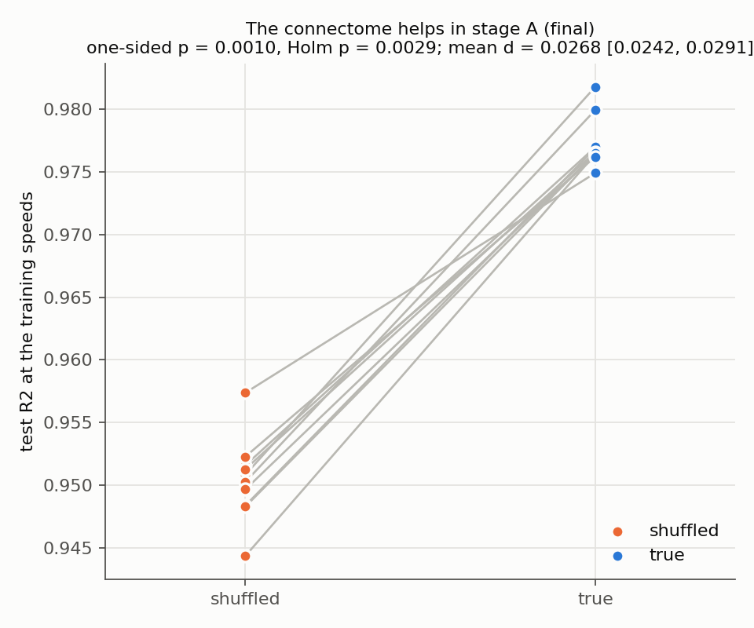

**Figure S1 | On the test split, `true` had a higher R2 than `shuffled` at the training speeds in every training seed.** Test R2 at the training speeds (60 and 120 deg/s) per training seed, `shuffled` (orange) and `true` (blue); grey lines join the two runs of a seed. The title gives the pre-registered verdict, the one-sided exact p, the Holm-adjusted p and mean d with its 95 % bootstrap interval. Test split, 10 training seeds per arm.

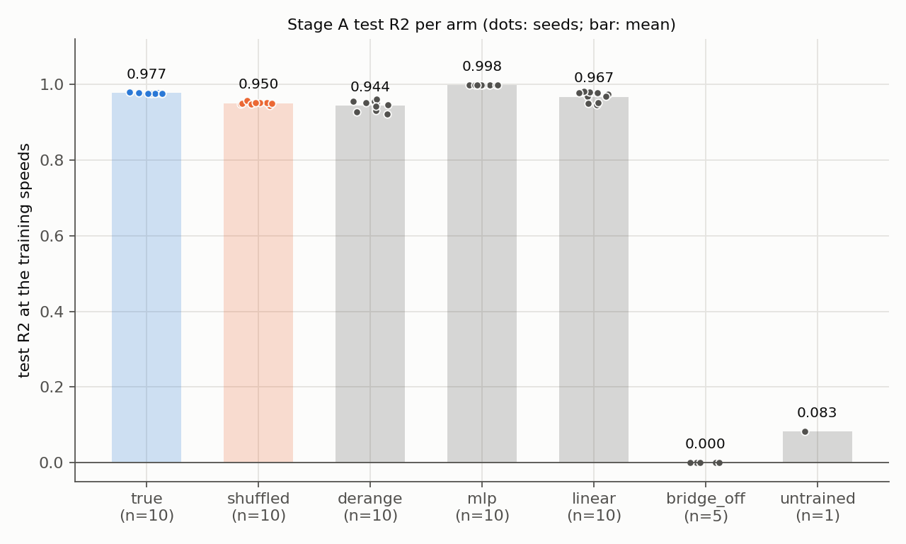

**Figure S2 | Test R2 at the training speeds for every arm.** Dots, training seeds; bars, arm means (printed above each bar); n, the number of training seeds of the arm. Test split.

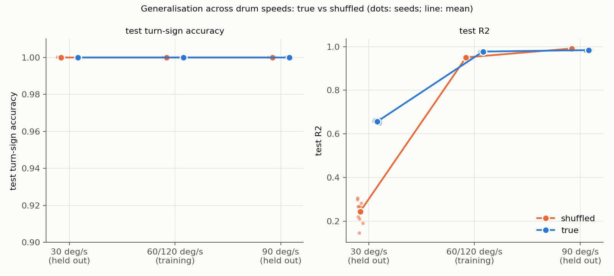

**Figure S3 | Across drum speeds `true` and `shuffled` had the same turn-sign accuracy on the test split, and differed in R2 mainly at 30 deg/s.** Left, test turn-sign accuracy; right, test R2; at 30 deg/s (held out), 60 and 120 deg/s (training) and 90 deg/s (held out); dots, training seeds; lines join the arm means; `shuffled` orange, `true` blue. Test split, 10 training seeds per arm.

## Validation and learning-rate selection

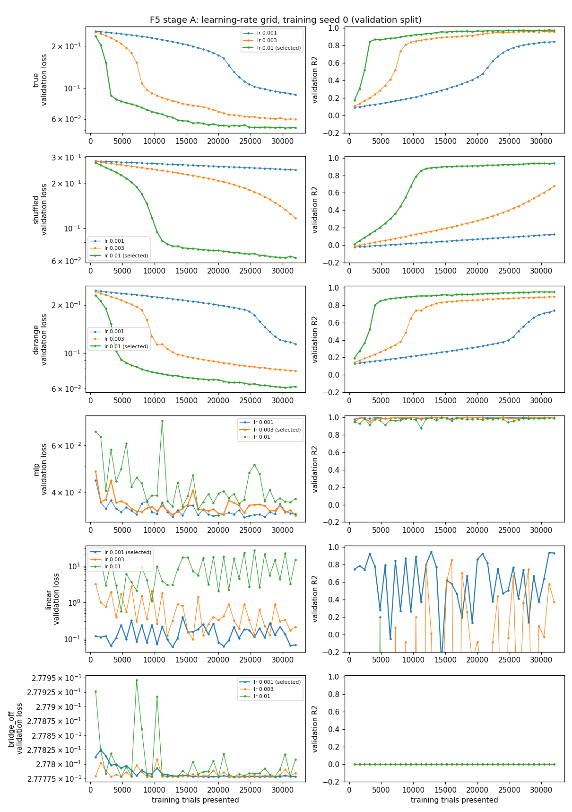

**Figure S4 | Learning-rate grid at training seed 0: validation loss and R2 over training, per arm and rate.** Rows, the arms `true`, `shuffled`, `derange`, `mlp`, `linear` and `bridge_off`; left, validation loss (log scale); right, validation R2 of the window mean; x, training trials presented; colours, the learning rates 0.001, 0.003, 0.01, the selected one marked in the legend. Validation split (used for selection); training seed 0. Figure 5 in the README shows the same validation evaluations.

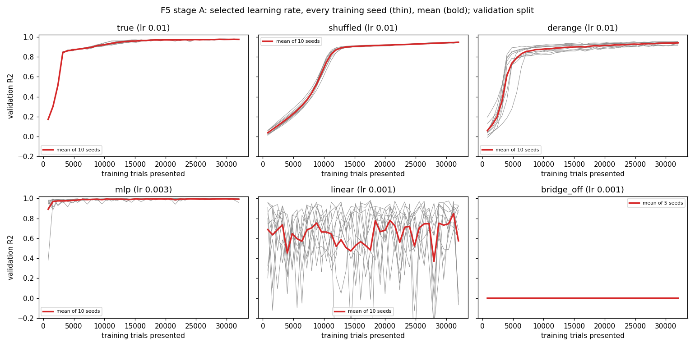

**Figure S5 | Validation R2 over training at each arm's selected learning rate.** One panel per arm, its rate in the title; thin grey lines, single training seeds; red, their mean. Validation split (used for selection); 10 training seeds per arm, 5 for `bridge_off`. Figure 5 in the README shows the same validation evaluations.

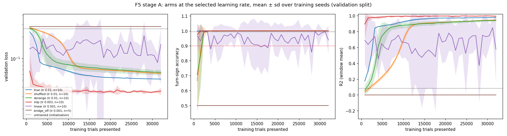

**Figure S6 | The arms at their selected learning rates over training.** Left, validation loss (log scale); centre, turn-sign accuracy (red dashed line, the 0.90 set-accuracy level); right, R2 of the window mean; x, training trials presented; lines, means over training seeds; shading, ± s.d.; dotted, `untrained` at initialisation; colours as in the legend (they differ from Figures 1 and 4). Validation split (used for selection). Figure 5 in the README shows the same validation evaluations.

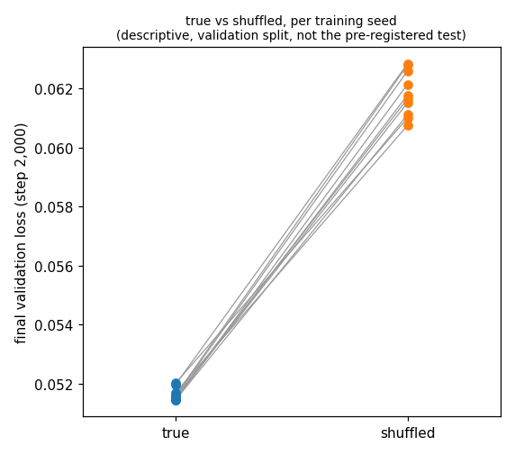

**Figure S7 | The final validation loss was lower for `true` than for `shuffled` in every training seed (descriptive).** Final validation loss (step 2,000) per training seed, `true` against `shuffled`; lines join the two runs of a seed. Validation split (used for selection); descriptive, not the pre-registered test; 10 training seeds per arm.

## Stimulus and visual input

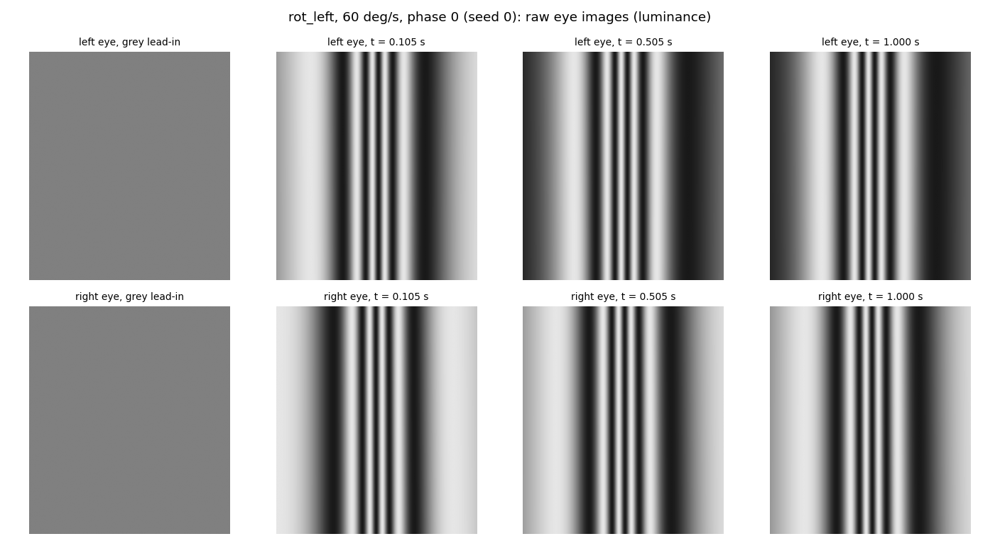

**Figure S8 | What the two eyes see: raw eye images during leftward rotation at 60 deg/s.** Luminance seen by the left (top row) and right (bottom row) FlyGym eye in the grey lead-in and at three times after the drum starts (times in the panel titles). Training data seed 0, grating phase 0.

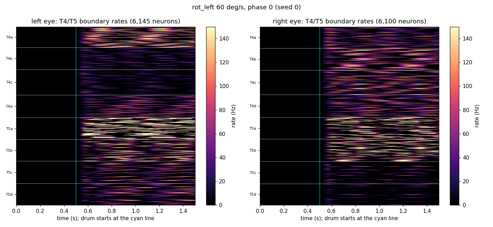

**Figure S9 | FlyVis T4/T5 boundary rates during leftward rotation at 60 deg/s.** Heat maps of the rates (Hz, colour bar) of the T4 and T5 boundary neurons over time, left and right eye, rows grouped by subtype (T4a-d, T5a-d); the cyan line marks the drum start. Training data seed 0.

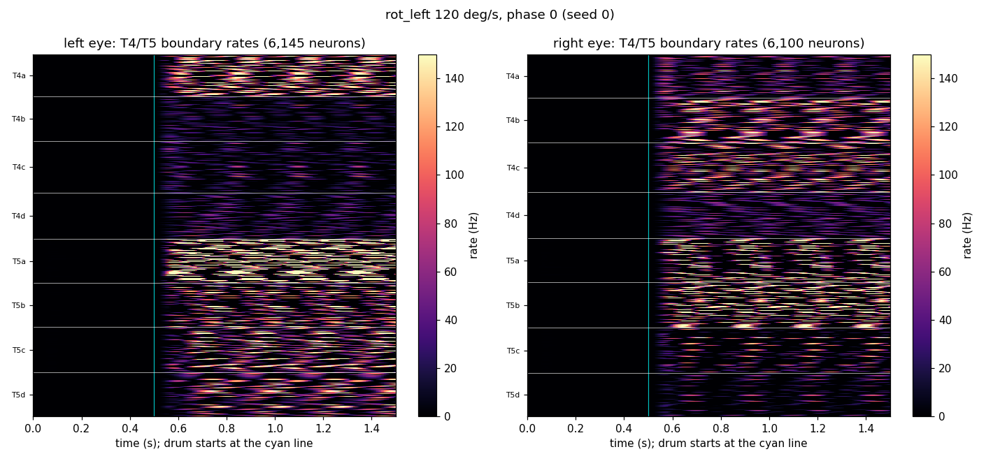

**Figure S10 | FlyVis T4/T5 boundary rates during leftward rotation at 120 deg/s.** As Figure S9. Training data seed 0.

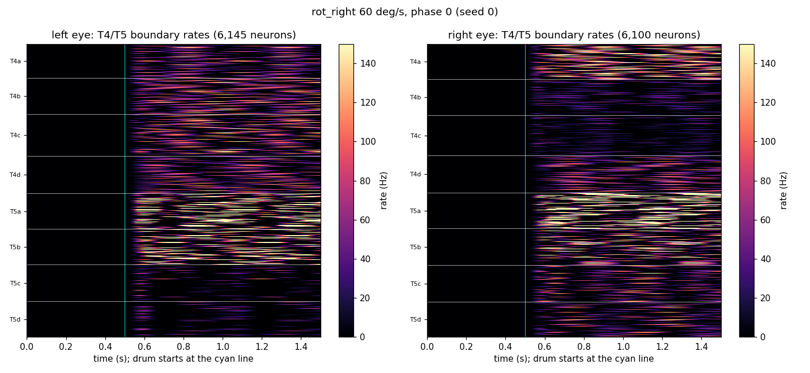

**Figure S11 | FlyVis T4/T5 boundary rates during rightward rotation at 60 deg/s.** As Figure S9. Training data seed 0.

## Video stills

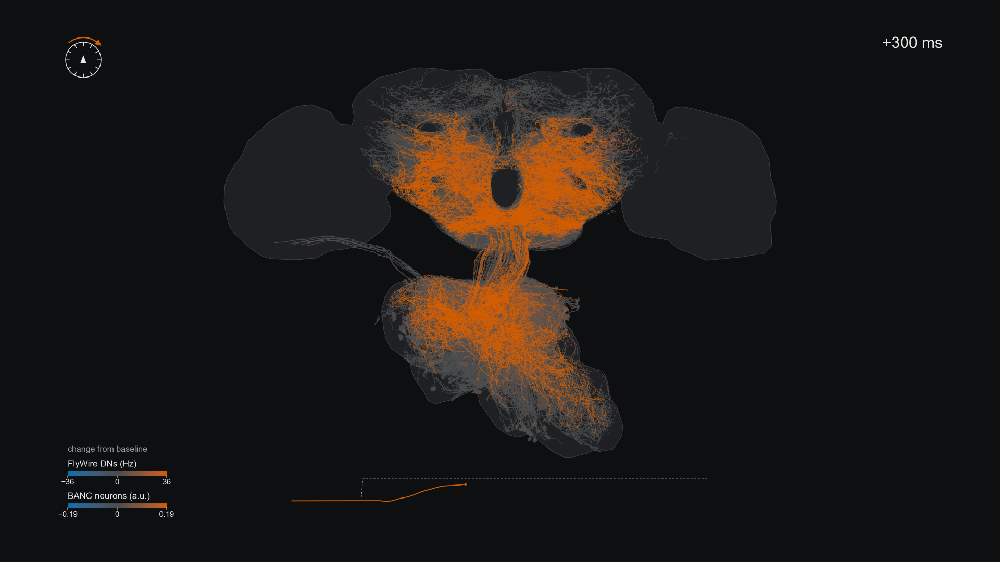

**Figure S12 | Act 1 of the circuit video at +300 ms: change from the pre-stimulus baseline during rightward rotation.** Each drawn neuron is coloured by its change from its own baseline (colour bars: FlyWire DNs in Hz, BANC neurons in model units); the inset trace is the turn command dA; dashed, the teacher dA*. 120 deg/s, mean over the validation data seeds 160-199.

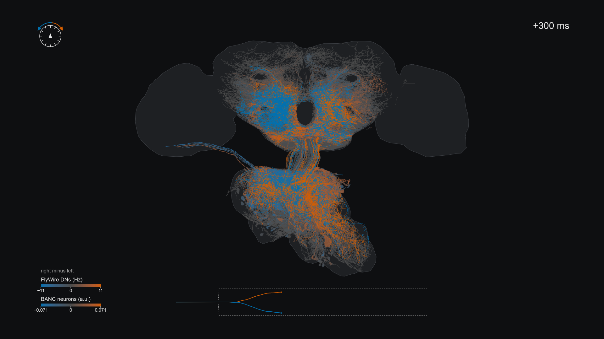

**Figure S13 | Act 2 of the circuit video at +300 ms: direction preference, rightward minus leftward rotation.** Orange prefers rightward, blue leftward (colour bars as in Figure S12); the inset shows dA for both directions. 120 deg/s, mean over the validation data seeds 160-199.

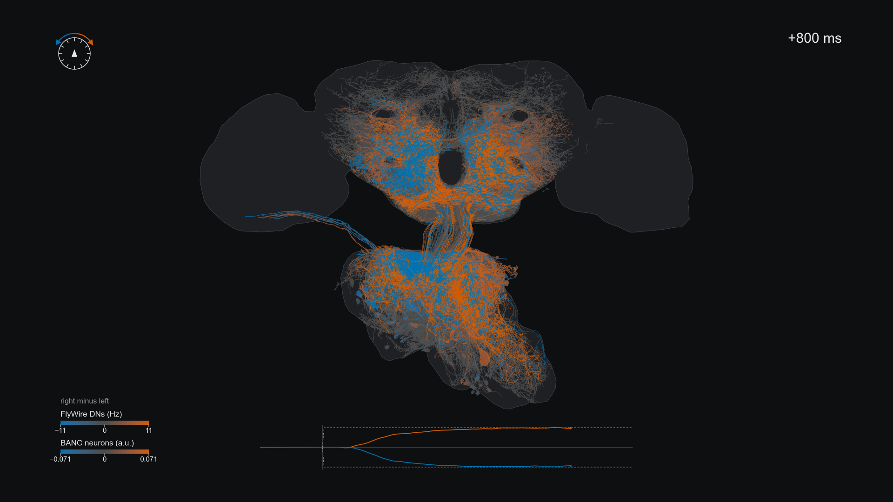

**Figure S14 | Act 2 of the circuit video at +800 ms.** As Figure S13, later in the trial.

## Alignment

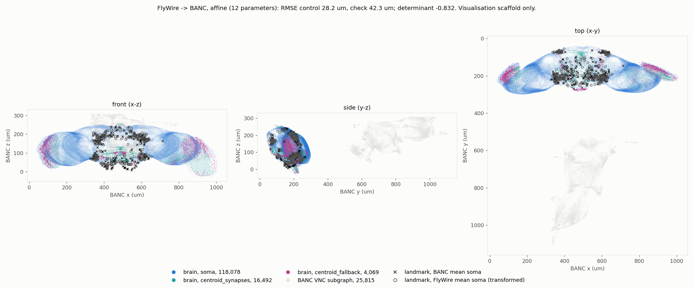

**Figure S15 | FlyWire brain-model neurons mapped into BANC space by our affine transform (a visualisation scaffold).** Front (x-z), side (y-z) and top (x-y) projections in BANC coordinates (µm); brain neurons coloured by the source of their position (soma, synapse centroid, fallback centroid), the BANC VNC subgraph in light grey, landmarks as crosses (BANC mean soma) and circles (transformed FlyWire mean soma). The title gives the landmark fit of the affine in `docs/figures/transforms.json`: RMSE 28.2 µm on the control points and 42.3 µm on the check points, determinant -0.832. Against the BANC team's warp (`docs/figures/warp_check.json`: our affine FlyWire soma against the root node of the BANC team's warped skeleton) the median distance was 14.5 µm over 264 DNs.
